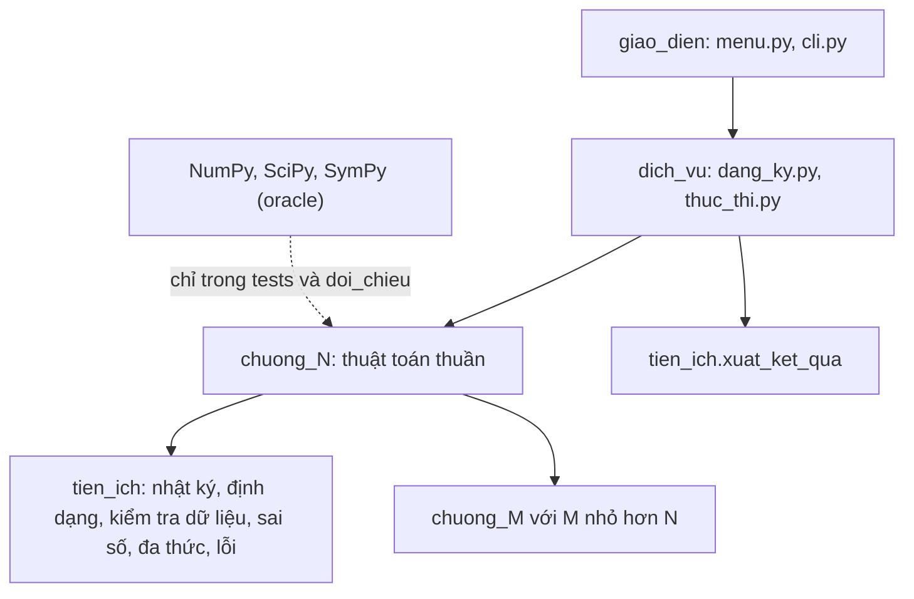
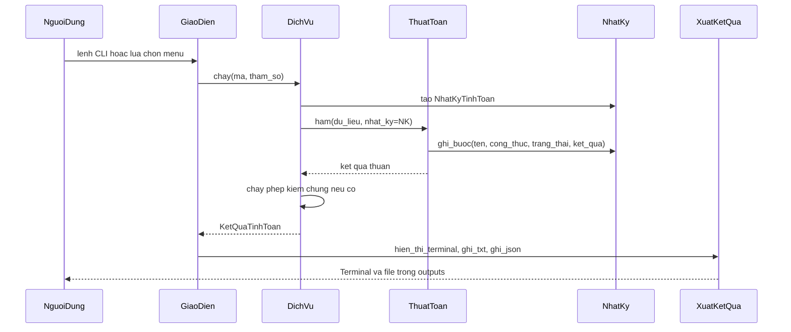
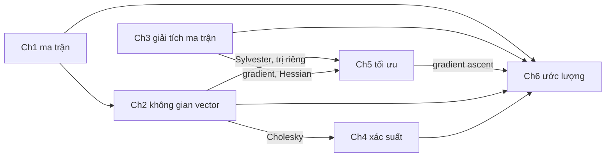

# Toán học cho Máy học (`mlmath`)

Dự án Bài tập lớn môn **Phương pháp toán cho Máy học** — cài đặt từ đầu các thuật toán Toán học cho Máy học bằng Python/NumPy theo quy trình Vibe Coding có kiểm soát.

Quyết định thiết kế và lý do nằm ở `handoff/QUYET_DINH_KIEN_TRUC.md`; chữ ký hàm nằm ở `handoff/HOP_DONG_MODULE.md`.

---

## 1. Cài đặt & Chạy chương trình

```bash
python -m venv .venv
source .venv/bin/activate        # macOS / Linux
# .venv\Scripts\activate         # Windows

pip install -r docs/requirements.txt
pip install -e .
```

Cài đặt tùy chọn (cho đối chiếu Quy hoạch toàn phương ở Chương 5):

```bash
pip install -r docs/requirements-optional.txt
```

**Cách gọi CLI và kiểm thử:**

```bash
# Giao diện menu tương tác
python -m mlmath.giao_dien menu

# Liệt kê các thuật toán đã đăng ký
python -m mlmath.giao_dien liet-ke --chuong 1

# Chạy một thuật toán qua CLI
python -m mlmath.giao_dien chay ch1.nghich_dao_gauss_jordan --ma-tran "[[1,2,-1],[1,2,1],[2,3,0]]" --xuat terminal,txt,json

# Chạy toàn bộ kiểm thử
pytest

# Bỏ qua các test chậm (đo thời gian Laplace, mô phỏng >= 10.000 mẫu)
pytest -m "not cham"
```

- CLI và menu **cùng** gọi `dich_vu.thuc_thi.chay`. Menu chỉ là cách hỏi tham số tương tác.
- Chuỗi ma trận trên dòng lệnh được phân tích bằng `ast.literal_eval` (không dùng `eval`); phần tử dạng `"1/2"` được đổi thành `Fraction`.
- Đường dẫn xuất mặc định: `chapters/<chương>/outputs/<ma_thuat_toan>_<yyyymmdd_hhmmss>.{txt,json}`.

---

## 2. Mục tiêu thiết kế

1. Mỗi thuật toán toán học chỉ có **một** bản cài đặt, dùng chung cho menu, CLI, test và các chương sau.
2. Người chấm tìm được mã của từng chương trong vài giây (xem mục 6).
3. Chạy chương trình cho thấy **quá trình** tính, không chỉ kết quả cuối.
4. Phân biệt rõ mã tự cài và thư viện dùng đối chiếu; có test tự động bảo vệ ranh giới này (`tests/unit/test_cam_thu_vien.py`).
5. Đủ đơn giản để từng thành viên giải thích được trong buổi vấn đáp: không dùng metaclass, plugin động, hay cây kế thừa sâu.

---

## 3. Kiến trúc ba lớp



| Lớp | Trách nhiệm | Không được làm |
|---|---|---|
| `giao_dien` | Đọc lệnh hoặc lựa chọn menu, phân tích tham số, gọi `dich_vu`, hiển thị | Chứa công thức hay logic thuật toán |
| `dich_vu` | Tra thuật toán trong bảng đăng ký, tạo nhật ký, đo thời gian, chạy phép kiểm chứng, đóng gói `KetQuaTinhToan` | In ra màn hình; ghi file |
| `chuong_N_*` | Thuật toán toán học; nhận và trả dữ liệu thuần; ghi bước vào `nhat_ky` | `print`, ghi file, đọc `argv`, phụ thuộc chương sau |
| `tien_ich` | Hạ tầng dùng chung | Chứa thuật toán của một chương cụ thể |
| `xuat_ket_qua` | Hiển thị Terminal; ghi TXT và JSON từ **một** cấu trúc `KetQuaTinhToan` | Tính toán lại kết quả |

---

## 4. Cấu trúc thư mục dự án

```text
BTL Toán ML/
├── README.md                          # Tài liệu tổng quan, kiến trúc & hướng dẫn chính
├── pyproject.toml                     # Cấu hình đóng gói thư viện `mlmath` (src/ layout)
├── pytest.ini                         # Cấu hình pytest (testpaths = tests chapters integration)
├── .gitignore                         # Bỏ qua __pycache__, .venv, .DS_Store, file tạm
│
├── docs/                              # Tài liệu hướng dẫn & nhật ký dự án
│   ├── CLAUDE.md, AGENTS.md           # Chỉ dẫn bắt buộc cho AI Agent (trỏ tới flow/RULES.md)
│   ├── HUONG_DAN_SU_DUNG.md           # Hướng dẫn cài đặt, gọi CLI/Python & chạy kiểm thử
│   ├── QUY_UOC_DAT_TEN.md             # Quy ước đặt tên biến/hàm và quy ước toán học theo slide
│   ├── PROMPT_LOG.md                  # Nhật ký prompt đầy đủ (AI tự động ghi sau mỗi lượt)
│   └── requirements*.txt              # Thư viện bắt buộc (numpy, scipy...) & tùy chọn (cvxopt)
│
├── handoff/                           # Tài liệu kỹ thuật & hợp đồng cho quá trình triển khai
│   ├── QUYET_DINH_KIEN_TRUC.md        # Các quyết định kiến trúc đã chốt (D01–D18)
│   ├── HOP_DONG_MODULE.md             # Chữ ký hàm, kiểu dữ liệu, điều kiện & ngoại lệ của 6 chương
│   ├── CHUAN_VIET_MA.md               # Chuẩn code Python, type hints, docstring, xử lý lỗi
│   ├── CHIEN_LUOC_KIEM_THU.md         # Chiến lược test 3 tầng (biên, oracle thư viện, tính chất)
│   ├── KE_HOACH_TRIEN_KHAI.md         # Thứ tự triển khai các giai đoạn
│   └── CONG_VIEC_TIEP_THEO.md         # Danh sách việc cần làm tiếp theo
│
├── flow/                              # Phần A (20%): Quy trình Vibe Coding có kiểm soát
│   ├── flow.mmd                       # Sơ đồ quy trình 8 bước
│   ├── RULES.md                       # Nguồn quy tắc duy nhất cho AI (ranh giới thư viện, tự ghi log)
│   ├── prompt_templates.md            # Các mẫu prompt chuẩn (sinh mã, sinh test, debug, giải thích)
│   ├── checklist.md                   # Danh sách kiểm tra trước khi hoàn thành mỗi hàm/chương
│   ├── risks.md                       # Bảng rủi ro toán học/số học/AI và cách phòng tránh
│   └── pilot/README.md                # Nhật ký chạy thử quy trình trên 1 hàm mẫu
│
├── src/mlmath/                        # Mã nguồn chính của thư viện (tất cả logic nằm tại đây)
│   ├── __init__.py
│   ├── loi.py                         # Hệ thống ngoại lệ chuẩn (LoiDuLieu, LoiKichThuoc, ...)
│   ├── ch1.py … ch6.py                # Alias tiếng Anh re-export để tương thích test mẫu (D02)
│   ├── tien_ich/                      # Hạ tầng dùng chung: nhật ký tính toán, định dạng ma trận,
│   │                                  # kiểm tra dữ liệu, sai số, đa thức, bảng tra phân vị, xuất KQ
│   ├── dich_vu/                       # Bảng đăng ký `DANG_KY` và hàm điều phối `chay(ma, ...)`
│   ├── giao_dien/                     # CLI (`cli.py`) và Menu tương tác (`menu.py`)
│   ├── chuong_1_ma_tran/              # Chương 1: Phép toán, dạng ma trận, Laplace/Gauss, hạng, nghịch đảo
│   ├── chuong_2_khong_gian_vector/    # Chương 2: Chuẩn, ĐLTT, đổi cơ sở, Gram–Schmidt, trị riêng, Cholesky, PCA
│   ├── chuong_3_giai_tich_ma_tran/    # Chương 3: Gradient/Jacobian/Hessian số, bảng đạo hàm, Taylor, cực trị
│   ├── chuong_4_xac_suat/             # Chương 4: Đếm, Bayes, phân phối, bất đẳng thức, Monte Carlo, Naive Bayes
│   ├── chuong_5_toi_uu/               # Chương 5: Tính lồi, QHTT, GD/Newton, Lagrange, QP, Logistic L2
│   └── chuong_6_uoc_luong/            # Chương 6: Đặc trưng mẫu, KTC, OLS, MLE, MAP, Gaussian Generative
│
├── chapters/                          # Phần B (60%): Hồ sơ, đặc tả, test & kết quả từng chương (ch1..ch6)
│   └── chX_*/
│       ├── README.md                  # Giới thiệu chương & lệnh chạy nhanh
│       ├── spec.md                    # Đặc tả I/O, công thức, biên, oracle (viết trước khi code)
│       ├── selfstudy.md               # Ghi chú tự học (chỉ có ở ch4_probability)
│       ├── NHAT_KY.md                 # Nhật ký phát triển của chương
│       ├── prompts.md                 # Trích các prompt tiêu biểu (gồm lần AI sai & cách sửa)
│       ├── analysis.md                # Phân tích kết quả đối chiếu & trả lời câu hỏi phản biện
│       ├── src/                       # `chay_chuong.py` (điểm vào mỏng) + `README.md` (bảng ánh xạ hàm)
│       ├── tests/                     # Bộ test của chương (unit + oracle + tính chất toán học)
│       ├── examples/                  # Bài tập mẫu & tối thiểu 2 bài tự đặt (.json + .md)
│       ├── doi_chieu/                 # Script đối chiếu với NumPy/SciPy/SymPy/sklearn
│       └── outputs/                   # Kết quả chạy thật (TXT, JSON, hình vẽ)
│
├── integration/                       # Phần C1: Mini-pipeline ML tích hợp từ Ch1–Ch6
│   ├── src/pipeline.py                # Chuẩn hóa → PCA → Logistic L2 → MLE/MAP & KTC
│   └── tests/                         # Kiểm thử cho pipeline tích hợp
│
└── tests/                             # Kiểm thử hạ tầng dùng chung & bảo vệ kiến trúc
    └── unit/
        ├── test_cam_thu_vien.py       # Quét AST toàn bộ `src/mlmath/` cấm dùng hàm thư viện vi phạm D03
        └── test_tien_ich.py           # Test cho `loi`, `tien_ich`, `dich_vu`
```

---

## 5. Luồng dữ liệu & Phụ thuộc giữa các chương

### Luồng dữ liệu khi chạy một thuật toán



### Phụ thuộc giữa các chương



Quy tắc: chương `N` chỉ được import từ chương `M < N`. Thứ tự triển khai: Ch1 → Ch2 → Ch3 → Ch4 → Ch5 → Ch6 → `integration/`.

| Hàm cần | Lấy từ |
|---|---|
| Giải hệ, nghịch đảo, hạng, định thức | Ch1 |
| Gram–Schmidt, Sylvester, Cholesky, trị riêng, không gian riêng | Ch2 |
| Gradient, Hessian | Ch3 |
| Kiểm tra lồi (Hessian xác định dương) | Ch3 và Ch2 |
| Sinh mẫu chuẩn nhiều chiều | Ch4 dùng Cholesky của Ch2 |
| OLS tổng quát (phương trình chuẩn) | Ch6 dùng Gauss–Jordan của Ch1 và gradient của Ch3 |
| Kiểm tra MLE bằng số | Ch6 dùng gradient ascent của Ch5 |

---

## 6. Bản đồ mã nguồn  

| Chương | Nội dung | Bảng ánh xạ mã nguồn |
|---|---|---|
| Chương 1 | Ma trận – Định thức | [chapters/ch1_linear_algebra/src/README.md](chapters/ch1_linear_algebra/src/README.md) |
| Chương 2 | Không gian vector – Ánh xạ tuyến tính | [chapters/ch2_vector_spaces/src/README.md](chapters/ch2_vector_spaces/src/README.md) |
| Chương 3 | Giải tích ma trận | [chapters/ch3_matrix_calculus/src/README.md](chapters/ch3_matrix_calculus/src/README.md) |
| Chương 4 | Xác suất (tự học) | [chapters/ch4_probability/src/README.md](chapters/ch4_probability/src/README.md) |
| Chương 5 | Các vấn đề về tối ưu hóa | [chapters/ch5_optimization/src/README.md](chapters/ch5_optimization/src/README.md) |
| Chương 6 | Đặc trưng mẫu & Phương pháp ước lượng | [chapters/ch6_estimation/src/README.md](chapters/ch6_estimation/src/README.md) |

---

## 7. Thêm một thuật toán mới (checklist)

1. Viết mục trong `chapters/chX_*/spec.md` (đầu vào, đầu ra, công thức, điều kiện, biên, oracle, DoD).
2. Viết test oracle **trước** khi sinh mã (xem `flow/RULES.md`).
3. Cài hàm trong `src/mlmath/chuong_N_*/`: thuần, có type hints, docstring, kiểm tra đầu vào bằng `xac_thuc_*`, ghi bước vào `nhat_ky`.
4. Thêm mục vào `src/mlmath/dich_vu/dang_ky.py` (mã, tên hiển thị, tham số, phép kiểm chứng).
5. Thêm alias vào `chX.py` nếu hàm có trong danh sách alias của D02.
6. Chạy test; tự động cập nhật `docs/PROMPT_LOG.md`, cùng `NHAT_KY.md`, `prompts.md` bằng những gì **đã thực sự xảy ra**.

---

## 8. Kiểm thử, Xử lý lỗi & Giới hạn

### Kiểm thử
Ba tầng kiểm thử (chi tiết ở `handoff/CHIEN_LUOC_KIEM_THU.md`): tự cài; đối chiếu thư viện; tính chất toán học. `pytest.ini` khai báo `testpaths = tests chapters integration`. Test chậm (đo thời gian Laplace, mô phỏng ≥ 10.000 mẫu) gắn `@pytest.mark.cham`.

### Xử lý lỗi
| Tình huống | Ngoại lệ |
|---|---|
| Kích thước không tương thích, không vuông khi cần vuông | `LoiKichThuoc` |
| Ma trận suy biến khi cần nghịch đảo | `LoiMaTranSuyBien` |
| Không đối xứng, không xác định dương, không chéo hóa được | `LoiDieuKien` |
| Giá trị `nan`, `inf`, kiểu dữ liệu không hỗ trợ | `LoiDuLieu` |
| Thuật toán lặp không hội tụ trong số vòng cho phép | `LoiHoiTu` |

### Giới hạn đã biết
- Laplace là `O(n!)` nên `dinh_thuc_laplace` giới hạn `n ≤ 9` trong phép đo thời gian.
- `da_thuc_dac_trung` mặc định chỉ cho `n ≤ 6` (D04); ma trận lớn hơn dùng đường nâng cao (`jacobi_doi_xung`).
- Mảng `dtype=object` (`Fraction`) chậm; chỉ dùng cho ví dụ nhỏ và hiển thị đáp án chính xác như bài giảng.
